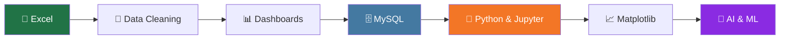

<div align="center">


<a href="https://github.com/devangxd-01">
  
</a>

<br/><br/>

[](https://www.linkedin.com/in/YOUR-LINKEDIN-ID)
[](mailto:YOUR-EMAIL@gmail.com)
[](https://github.com/devangxd-01)


</div>

---

## 👨‍💻 About Me

```python
class Devang:
    name      = "Devang Bhardwaj"
    pronouns  = "he/him"
    studying  = "MCA (AI & ML) @ Invertis University"
    role      = ["Python Developer", "Data Analytics Enthusiast"]
    tools     = ["Excel", "MySQL", "Python", "Jupyter", "Matplotlib", "Power BI"]
    mentor    = "Divyank Chauhan Sir"
    motto     = "Learn it. Build it. Ship it."

    def say_hi(self):
        return "Let's turn data into decisions! 🚀"

print(Devang().say_hi())
```

- 🔭 **Currently working on:** Data analytics projects and dashboards
- 🌱 **Always learning:** Python, SQL, data visualization, React and Node
- 🎯 **Goal:** Clean, scalable and user-focused solutions
- 💬 **Ask me about:** Excel dashboards, SQL queries, Matplotlib charts
- ⚡ **Fun fact:** I turned my learning log into a 15-day data analytics journey!

---

## 🛠️ Tech Stack

<div align="center">

**📊 Data & Analytics**


**🌐 Web Development**


**🧰 Tools**


</div>

---

## 🚀 Featured Projects

<table>
<tr>
<td width="50%" valign="top">

### ✈️ Aviation Dashboard
Interactive airline customer analysis with class slicers, delay analysis, loyal vs disloyal customers and age/gender distribution.


</td>
<td width="50%" valign="top">

### 🎵 Spotify Dashboard
Excel dashboard on Kaggle music data with KPI cards, pivot-style summaries and charts by genre, year and artist.


</td>
</tr>
<tr>
<td width="50%" valign="top">

### 📘 Data Analytics Daily Task
My 15-day journey from Excel basics to MySQL, Jupyter and dashboards.

[](https://github.com/devangxd-01/Data_analytics_daily_task)

</td>
<td width="50%" valign="top">

### 🐍 Python + SQL + Matplotlib
Jupyter notebooks covering charts built one by one and SQL connected to Python.


</td>
</tr>
</table>

---

## 📊 GitHub Stats

<div align="center">


<br/>


<br/>


</div>

---

## 🏆 Trophies

<div align="center">

</div>

---

## 🐍 Contribution Snake

<div align="center">
<picture>
  <source media="(prefers-color-scheme: dark)" srcset="https://raw.githubusercontent.com/devangxd-01/devangxd-01/output/github-snake-dark.svg" />
  <source media="(prefers-color-scheme: light)" srcset="https://raw.githubusercontent.com/devangxd-01/devangxd-01/output/github-snake.svg" />
  
</picture>
</div>

---

## 🧭 Explore More

<details>
<summary><b>📈 My Learning Roadmap (click to open)</b></summary>
<br/>



</details>

<details>
<summary><b>🎯 What I'm learning right now (click to open)</b></summary>
<br/>

- 🐍 Advanced Python and Pandas
- 🗄️ SQL joins and database connections
- 📊 Power BI and storytelling with data
- 🤖 Machine learning fundamentals
- ⚛️ React, Node and TypeScript

</details>

<details>
<summary><b>🤝 Let's collaborate (click to open)</b></summary>
<br/>

I'm happy to work on data analytics projects, dashboards, Python automation and web apps. Drop me a message on LinkedIn or email and let's build something great.

</details>

---

<div align="center">

### 💭 Thought of the moment


<br/><br/>

**⭐ If you like my work, drop a star on my repositories! ⭐**


</div>
